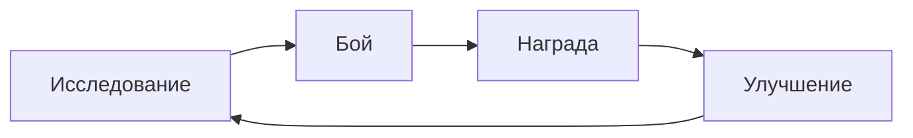

# Core Loop — основной игровой цикл

То, что игрок делает **снова и снова**. Если этот цикл не интересен — остальное не спасёт.

## Секундный цикл (что делают руки)
> Пример: двигаться → целиться → стрелять → уворачиваться

## Минутный цикл (что делает игрок в рамках одной стычки / комнаты)
> Пример: зачистить комнату → собрать лут → выбрать путь

## Часовой цикл (зачем играть дальше)
> Пример: пройти забег → потратить валюту на улучшения → начать новый забег сильнее

Механики цикла: [[Механики]] · Как растёт игрок: [[Прогрессия]]
