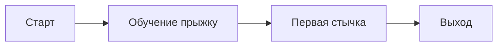

# Уровень 01

## Цель уровня
Чему учит игрока? Какое чувство вызывает?

## Новые механики / враги
- [[Передвижение]]

## Схема
Нарисуйте блок-схему или вставьте скриншот блокаута.

## Ключевые моменты (beats)
1. 
2. 

## Unreal
- Карта: `Content/_Game/Maps/L_Level01`
- World Partition: да / нет
- Нужные ассеты: см. [[Список ассетов]]

## Открытые вопросы
- [ ] 
